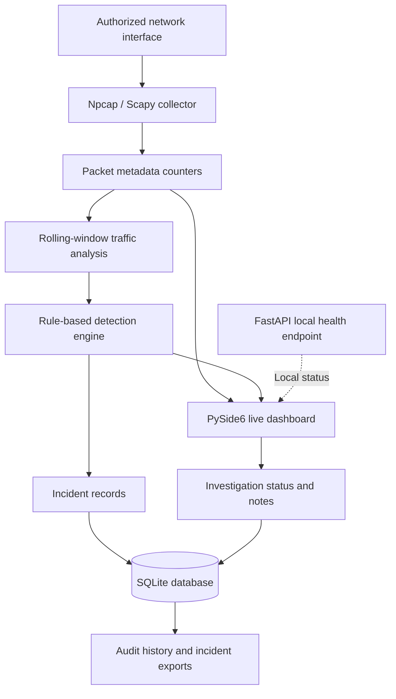

# VONKA SENTINEL-X — Architecture

## Architecture diagram

## Component responsibilities

- **Collector:** passively observes authorized traffic and updates counters. Packet payloads are not intentionally retained by the collector.
- **Rolling analysis and detection:** evaluates traffic rates and configured indicators. Alerts are signals to investigate, not proof of an attack.
- **PySide6 dashboard:** presents traffic statistics, protocol distribution, alerts, and investigation controls.
- **SQLite:** persists incidents and investigation audit events locally.
- **FastAPI:** provides a local health endpoint.

## Data flow

1. Traffic is observed on the selected interface.
2. The collector updates packet, byte, protocol, and rolling-rate statistics.
3. Detection rules evaluate the snapshot and may create alerts.
4. The dashboard displays metrics and alerts.
5. Investigation changes and audit events are stored locally.
6. Authorized users can export incident information for review.

## Security boundaries

- Use only interfaces and networks you are authorized to monitor.
- Keep the API bound to localhost for local use.
- Do not publish live traffic logs, databases, credentials, or private incident notes.
- This project does not automatically block traffic or guarantee DDoS prevention.
